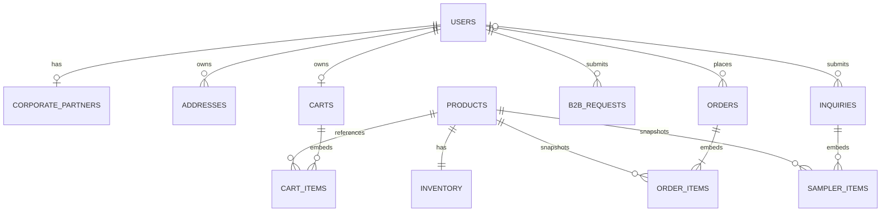

# SolCacao Database Schema Design

**Course deliverable:** Phase 1 database schema design  
**Database:** MongoDB  
**Status:** Phase 1 design contract; implementation is scheduled for Phase 2

## 1. Design goals

The schema supports two related journeys:

- Retail browsing, cart management, and simulated checkout
- Business account registration, quote requests, and private file metadata

The design uses explicit MongoDB collections, strict application schemas, normalized user-owned data, and snapshots for historical order and inquiry data. All timestamps are stored as ISO-compatible dates. Monetary values are integer USD cents.

MongoDB references are validated by services because MongoDB references do not enforce foreign keys. Private fields such as password hashes and private file keys are removed by serializers before API responses.

## 2. Collections and fields

### 2.1 `users`

| Field | Type | Rules |
| --- | --- | --- |
| `_id` | MongoDB ObjectId | Primary identifier; exposed as a string in DTOs |
| `name` | string | Required; trimmed |
| `email` | string | Required; normalized lowercase; unique |
| `passwordHash` | string | Required for persisted accounts; never serialized |
| `role` | enum | `retail` or `b2b` |
| `active` | boolean | Required; defaults to `true` |
| `createdAt` | date | Required |
| `updatedAt` | date | Required |

**Indexes:** unique `email`.

A user may have many addresses and orders, at most one cart, and at most one corporate partner profile. A B2B user owns the quote requests associated with that account.

### 2.2 `corporatePartners`

| Field | Type | Rules |
| --- | --- | --- |
| `_id` | MongoDB ObjectId | Primary identifier |
| `userId` | ObjectId reference | Required; unique reference to `users` |
| `companyName` | string | Required; trimmed |
| `createdAt` | date | Required |
| `updatedAt` | date | Required |

**Indexes:** unique `userId`.

This collection stores B2B profile data only. It does not contain separate credentials.

### 2.3 `addresses`

| Field | Type | Rules |
| --- | --- | --- |
| `_id` | MongoDB ObjectId | Primary identifier |
| `userId` | ObjectId reference | Required; ownership boundary for every read and write |
| `label` | string | Required, such as billing or shipping |
| `recipientName` | string | Required |
| `line1` | string | Required |
| `line2` | string | Optional |
| `city` | string | Required |
| `region` | string | Required |
| `postalCode` | string | Required |
| `country` | string | Required |
| `createdAt` | date | Required |
| `updatedAt` | date | Required |

**Indexes:** `userId`.

All address queries and upserts must include the authenticated `userId`.

### 2.4 `products`

| Field | Type | Rules |
| --- | --- | --- |
| `_id` | MongoDB ObjectId | Primary identifier |
| `slug` | string | Required; unique and URL-safe |
| `name.en` / `name.es` | string | Required localized product names |
| `description.en` / `description.es` | string | Required localized descriptions |
| `ingredients.en` / `ingredients.es` | string[] | Required localized ingredient lists |
| `allergens.en` / `allergens.es` | string[] | Required localized allergen lists |
| `category` | string | Required |
| `origin` | string | Required |
| `cacaoPct` | integer | Required; percentage from 0 through 100 |
| `priceCents` | integer | Required; nonnegative USD cents |
| `currency` | string | Required; `USD` |
| `images` | string[] | Public asset references only |
| `active` | boolean | Required; inactive products are unavailable for new purchases |
| `createdAt` | date | Required |
| `updatedAt` | date | Required |

**Indexes:** unique `slug`; additional filter indexes are added only for observed query shapes.

### 2.5 `inventory`

| Field | Type | Rules |
| --- | --- | --- |
| `_id` | MongoDB ObjectId | Primary identifier |
| `productId` | ObjectId reference | Required; unique reference to `products` |
| `availableUnits` | integer | Required; nonnegative |
| `createdAt` | date | Required |
| `updatedAt` | date | Required |

**Indexes:** unique `productId`.

Each product has one inventory record. Inventory is serialized into the product response rather than exposed as an unrelated client concern.

### 2.6 `carts`

| Field | Type | Rules |
| --- | --- | --- |
| `_id` | MongoDB ObjectId | Primary identifier |
| `userId` | ObjectId reference | Required; unique reference to `users` |
| `items` | embedded array | Product IDs and positive quantities |
| `revision` | integer | Required; incremented for optimistic concurrency |
| `mergeIds` | string[] | Bounded list of processed guest-cart merge identifiers |
| `createdAt` | date | Required |
| `updatedAt` | date | Required |

Each embedded item contains `productId` and `quantity`. **Indexes:** unique `userId`.

Cart updates and guest-cart merges must use atomic revision checks. Product availability and active status are revalidated by the service.

### 2.7 `orders`

| Field | Type | Rules |
| --- | --- | --- |
| `_id` | MongoDB ObjectId | Primary identifier |
| `userId` | ObjectId reference or null | Optional for guest checkout |
| `email` | string | Required checkout contact; normalized |
| `address` | object | Required address snapshot |
| `items` | embedded array | Required item snapshots |
| `totalCents` | integer | Required; nonnegative USD cents |
| `currency` | string | Required; `USD` |
| `status` | enum | `simulated` for the project scope |
| `requestId` | string | Required; unique idempotency key |
| `requestHash` | string | Required request consistency value |
| `createdAt` | date | Required |
| `updatedAt` | date | Required |

Each order item stores `productId`, product name snapshot, `unitPriceCents`, and `quantity`. **Indexes:** unique `requestId`; optional `userId` query index.

Orders preserve submitted names, prices, and addresses so later product edits do not change historical receipts.

### 2.8 `b2bRequests`

| Field | Type | Rules |
| --- | --- | --- |
| `_id` | MongoDB ObjectId | Primary identifier |
| `userId` | ObjectId reference | Required; must belong to a B2B user |
| `quoteInput` | object | Required validated quote wizard input |
| `requestId` | string | Required idempotency key |
| `requestHash` | string | Required request consistency value |
| `fileKey` | string | Optional private storage key; never public |
| `fileOriginalName` | string | Optional metadata only |
| `fileMime` | string | Optional validated MIME type |
| `fileSize` | integer | Optional; bounded nonnegative size |
| `fileDigest` | string | Optional integrity digest |
| `status` | enum | `submitted` |
| `notificationStatus` | enum | Notification delivery state |
| `createdAt` | date | Required |
| `updatedAt` | date | Required |

**Indexes:** unique compound `(userId, requestId)`.

The upload itself is not stored in request JSON. Only validated metadata and a private file key are persisted.

### 2.9 `inquiries`

| Field | Type | Rules |
| --- | --- | --- |
| `_id` | MongoDB ObjectId | Primary identifier |
| `input` | object | Required validated contact, feedback, or sampler input |
| `samplerItems` | embedded array | Optional product and quantity snapshots |
| `requestId` | string | Required unique idempotency key |
| `requestHash` | string | Required request consistency value |
| `status` | enum | `received` |
| `notificationStatus` | enum | Notification delivery state |
| `createdAt` | date | Required |
| `updatedAt` | date | Required |

**Indexes:** unique `requestId`.

A six-piece sampler is represented as an inquiry with item snapshots; it is not a separately priced product.

## 3. Relationships

Embedded cart, order, and sampler item arrays are intentional. Carts need atomic updates, while orders and inquiries need immutable snapshots of submitted product information.

## 4. Validation and consistency rules

1. Validate request bodies at the server boundary and apply the same DTO semantics defined in `contracts/index.ts` and `docs/contracts.md`.
2. Normalize emails before enforcing uniqueness.
3. Reject negative quantities, prices, inventory values, and file sizes.
4. Revalidate referenced users and products because MongoDB references are not foreign keys.
5. Reject inactive or unavailable products during cart and checkout operations.
6. Constrain every user-owned read and write by authenticated ownership.
7. Use idempotency keys and request hashes for order, B2B request, and inquiry retries.
8. Use atomic revision updates for cart writes and merge operations.
9. Keep password hashes, private file keys, request hashes, and internal notification details out of public serializers.
10. Registration that creates both a user and partner profile must roll back on failure or use an approved transaction design.

This design relies on service validation and atomic writes rather than database triggers.

## 5. Ownership and implementation plan

| Area | Owner | Phase 2 implementation boundary |
| --- | --- | --- |
| Users, corporate partners, addresses | Student 1 | Auth and account services |
| Products, inventory, carts, orders | Student 3 | Catalog, cart, and simulated checkout services |
| B2B requests and private file metadata | Student 4 | Quote wizard and upload service |
| Inquiries and sampler snapshots | Student 5 | Contact, feedback, sampler, and notification service |
| Contracts, route assembly, and shared documentation | Student 2 | Integration coordination and shared shell |

This document captures the Phase 1 schema contract. It does not claim that MongoDB persistence, SMTP, or real file storage are already implemented.
